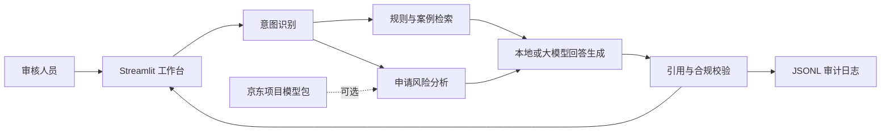

# 系统架构

## 数据流

## 节点职责

| 节点 | 输入 | 输出 | 设计目的 |
|---|---|---|---|
| 意图识别 | 用户问题 | rule_query / case_search / case_review / metric_query | 让不同问题进入正确流程 |
| 知识检索 | 问题与结构化特征 | Top-K 规则或案例 | 限制回答证据范围 |
| 风险分析 | 单笔申请字段 | 风险分数、等级、风险信号 | 提供可解释的初审信息 |
| 回答生成 | 检索证据与风险信号 | 审核建议 | 默认可离线运行 |
| 合规校验 | 回答与引用 | 带免责声明的最终结果 | 避免无依据结论与自动审批表述 |
| 审计留痕 | 工作流状态 | JSONL 事件 | 支持复盘和问题定位 |

## 技术选择

- 检索：中文字符 n-gram TF-IDF 向量空间，适合小型中文规则库且可离线复现。
- 工作流：显式状态节点，便于面试展示、单元测试和后续替换为 LangGraph/LangChain。
- 生成：本地证据摘要为默认方案，GPT/Claude 为可选增强。
- 风险预测：优先复用信贷项目的 Platt 校准 XGBoost；模型不可用时使用透明启发式评分并明确标识。
- 界面：Streamlit，便于快速验证产品流程。

## 产品安全边界

- 不上传真实身份证号、手机号、银行卡号或客户姓名。
- 回答必须包含证据编号；检索置信度过低时提示人工确认。
- 输出是辅助审核意见，不能自动替代授信、拒贷或合规判断。
- 每次审核记录输入摘要、命中证据、系统模式与时间戳。
